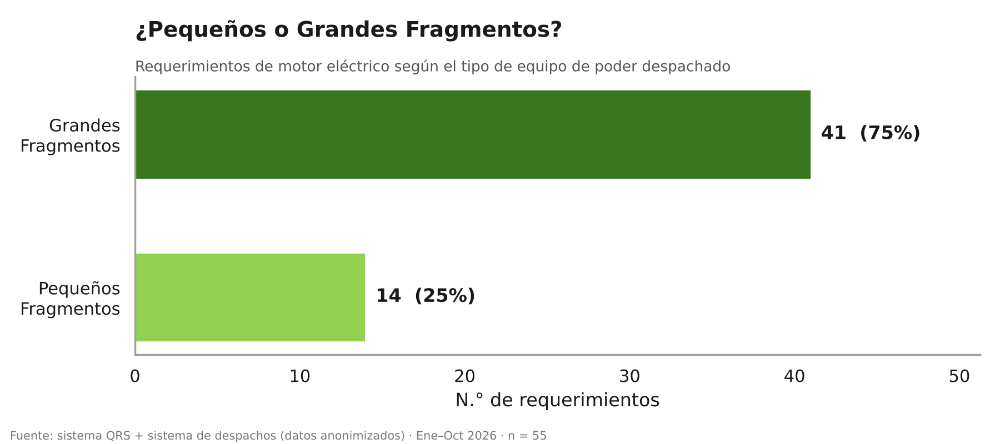
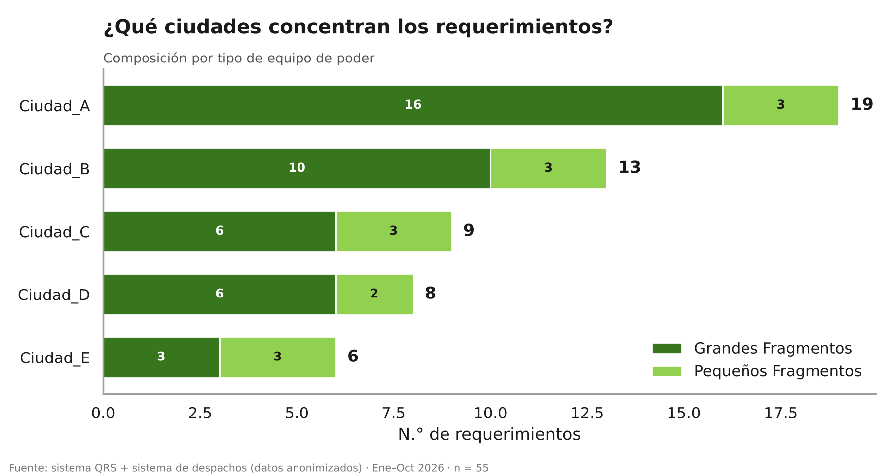
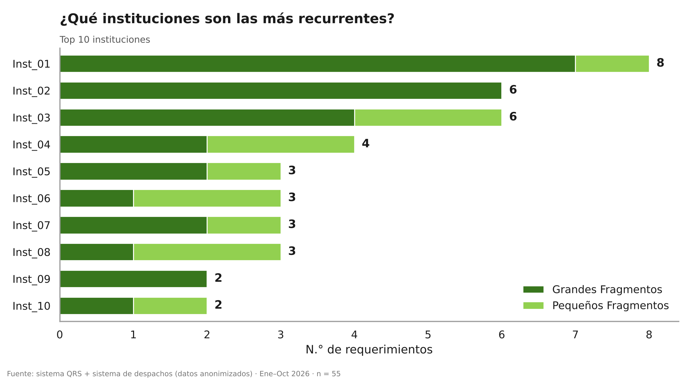
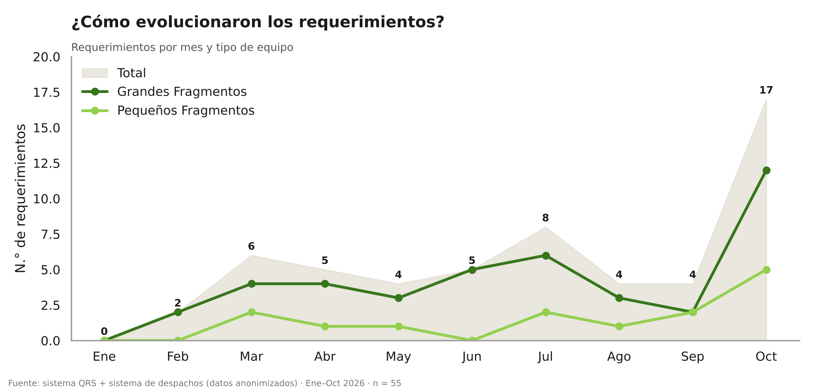
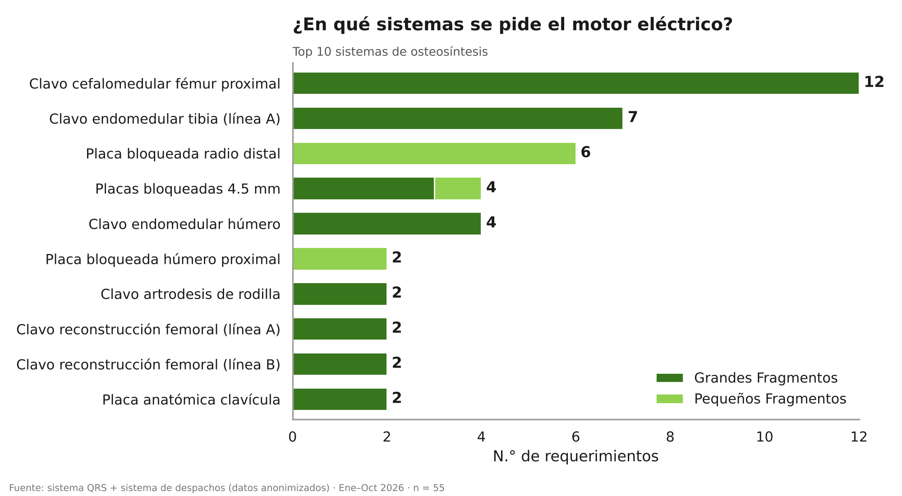
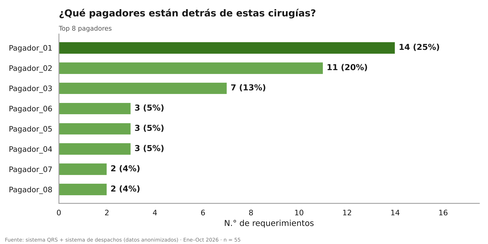
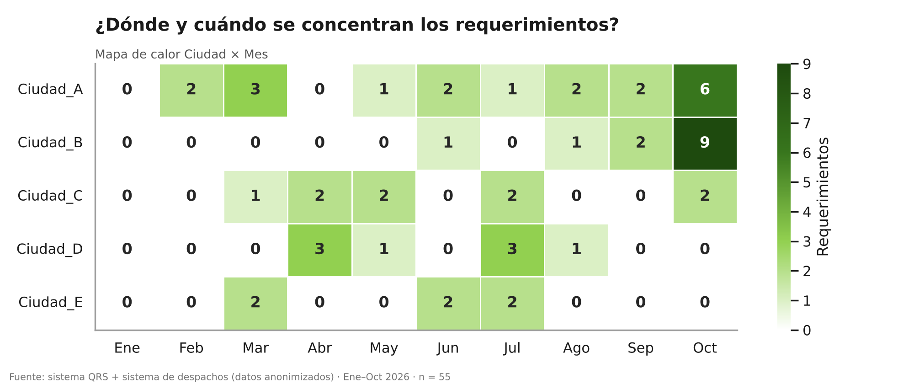
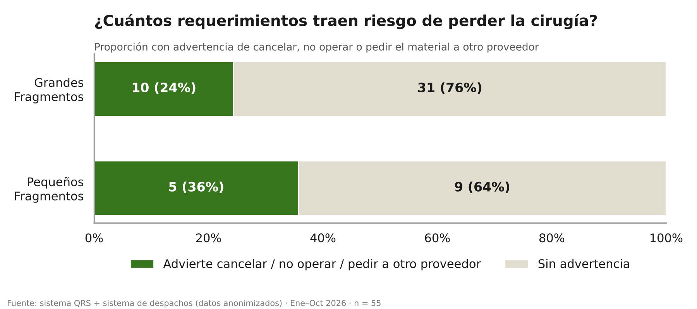
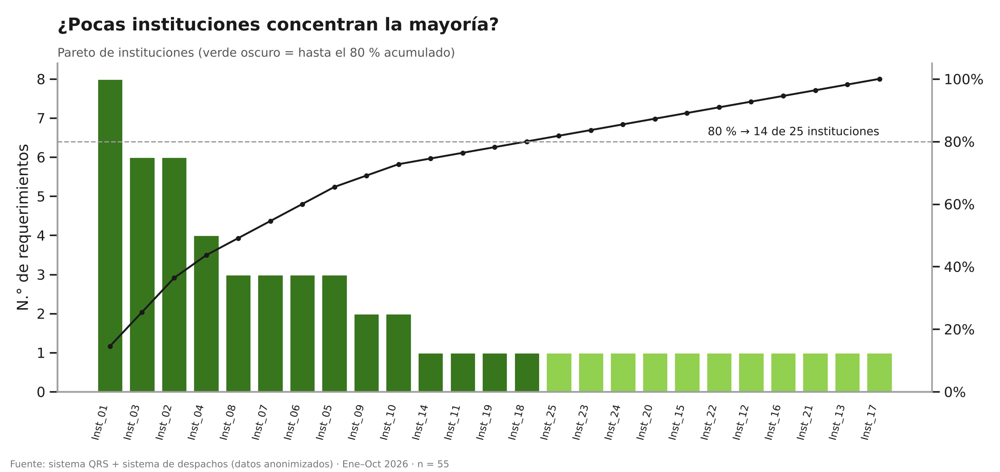

# ¿Por qué los cirujanos ya no quieren motores con manguera?
### Análisis de datos de quejas y sugerencias (QRS) para cuantificar la demanda de equipos de poder eléctricos

**Sector:** dispositivos médicos · ortopedia y trauma  **Periodo:** enero – octubre 2026  **Rol:** Analista de datos (de punta a punta)
**Herramientas:** Python (pandas, NumPy, Matplotlib, Seaborn) · API REST de SharePoint · Excel · Google Colab · IA generativa como asistente de análisis

> Los datos están anonimizados: ciudades, instituciones, pagadores y remisiones están codificados (`Ciudad_A`, `Inst_01`, `Pagador_01`, `REM_001`) y los nombres comerciales de los sistemas se reemplazaron por descripciones genéricas.

---

## Resumen en 30 segundos

| 55 | 75 % | 58 % | 27 % |
|:---:|:---:|:---:|:---:|
| requerimientos de motor eléctrico identificados en texto libre | corresponden a equipos de **Grandes Fragmentos** | se concentran en **dos ciudades** de una misma región | advierten **cancelar la cirugía o cambiar de proveedor** |

**El hallazgo:** la demanda de motores eléctricos no es un comentario aislado. Se concentra en un tipo de equipo, en una región y en pocas instituciones, y uno de cada cuatro reportes pone en riesgo la cirugía. Eso permite priorizar dónde y en qué invertir.

### Resumen ejecutivo del informe

| N.° | Pregunta | Respuesta |
|:---:|---|---|
| 1 | ¿Cuántos requerimientos corresponden a Pequeños y a Grandes Fragmentos? | 41 (75 %) a Grandes Fragmentos y 14 (25 %) a Pequeños Fragmentos |
| 2 | ¿Qué ciudades concentran los requerimientos? | Ciudad_A (19) y Ciudad_B (13) suman 32 de 55 (58 %) |
| 3 | ¿Qué instituciones presentan más requerimientos? | Las 3 primeras suman 20 (36 %) |
| 4 | ¿Cómo evolucionaron durante 2026? | Octubre registró 17, el valor más alto del periodo |
| 5 | ¿En qué sistemas se pide el motor eléctrico? | Clavo de fémur proximal (12) y clavo de tibia (7) |
| 6 | ¿Qué pagadores están asociados? | Dos pagadores suman 25 (45 %) |
| 7 | ¿Dónde y cuándo se concentran? | Ciudad_B pasó de 2 a 9 entre septiembre y octubre |
| 8 | ¿Cuántos advierten la posible pérdida de la cirugía? | 15 de 55 (27 %) |
| 9 | ¿Cuántas instituciones explican la mayoría? | 14 de 25 explican el 80 % |

---

## 1. La historia: una necesidad escondida en texto libre

En cada cirugía de trauma, la empresa presta sus **equipos de poder**: los motores, perforadores y sierras con los que el cirujano perfora el hueso, fresa el canal medular o corta. Parte de ese inventario todavía es **neumático**: funciona con una manguera conectada a una bala de nitrógeno.

En el quirófano, esa manguera se nota. Los reportes del equipo de soporte la describen así:

- *"La manguera se enreda y entorpece el procedimiento."*
- *"¿Dónde vamos a meter la bala del nitrógeno, ya que el quirófano es pequeño?"*
- *"La manguera es un foco de infección altísimo."*
- *"Dicen que somos los únicos que seguimos con estos motores."*

Los cirujanos pedían **motores eléctricos de batería**. Pero esas peticiones llegaban al sistema de **Quejas, Reclamos y Sugerencias (QRS)** como texto libre, mezcladas con cientos de reportes sobre implantes, despachos o instrumental. Todos sabían que "a los doctores no les gusta el motor de manguera", pero **nadie sabía cuántas veces se había pedido, dónde ni para qué tipo de equipo**.

Esto tenía consecuencias concretas que aparecían en los mismos reportes: cirugías retrasadas mientras se conseguía otro motor, mangueras que se reventaban en pleno procedimiento y especialistas que advertían cancelar el paciente o pedir el material a otra casa. Sin cifras, la necesidad no podía llegar a la mesa donde se deciden las compras.

**Pregunta de negocio:**
> ¿Cuál es la demanda real de motores eléctricos, en qué tipo de equipo (**Pequeños** o **Grandes Fragmentos**) y dónde se concentra, para sustentar una decisión de inversión?

---

## 2. El recorrido: de ≈1.000 registros a 55 requerimientos confiables

```
 ≈1.000 QRS          ≈500 QRS            162 relacionados       60 piden motor        55 con tipo de
 en SharePoint  ──►  ene–oct 2026  ──►   con equipos de   ──►   eléctrico /     ──►   equipo identificado
 (API REST)          (filtro fecha)      poder (lectura          rechazan el          (cruce con sistema
                                         semántica + IA)         neumático            de despachos)
```

1. **Extracción.** Las copias en Excel estaban desactualizadas o eran libros con macros que no se podían leer. Fui a la fuente: la lista de SharePoint Online que alimenta la consulta de QRS, extraída completa por medio de su **API REST** con paginación.
2. **Limpieza y trazabilidad.** Trabajé sobre una copia, normalicé textos sin alterar su contenido y apliqué una regla de **deduplicación** explícita (misma descripción + institución + remisión). Cada exclusión quedó documentada.
3. **Clasificación del texto libre con apoyo de IA.** Un filtro de palabras clave no alcanza: un cirujano puede decir *"no quiero seguir con el de aire"* sin escribir "motor" ni "neumático". Leí las ≈500 descripciones con **apoyo de IA generativa** y las clasifiqué en 5 categorías con criterios escritos: falla del equipo, **preferencia por motor eléctrico**, accesorios, logística y mantenimiento. Resultado: **1 de cada 3 QRS** del periodo tenía que ver con equipos de poder.
4. **Variable de riesgo.** Con **expresiones regulares** marqué los reportes en los que el especialista advierte cancelar la cirugía, no volver a operar o pedir el material a otro proveedor.
5. **Enriquecimiento.** Crucé cada número de remisión con una consulta del sistema de despachos para saber qué **tipo de equipo de poder** se había enviado.
6. **Análisis y comunicación.** Formulé 9 preguntas de negocio, elegí el gráfico adecuado para cada una y preparé un informe ejecutivo para la alta dirección.

---

## 3. Los hallazgos

### Hallazgo 1 · La necesidad está en Grandes Fragmentos
**¿Cuántos requerimientos corresponden a Pequeños y a Grandes Fragmentos?**



**Respuesta:** 41 de 55 requerimientos (**75 %**) corresponden a **Grandes Fragmentos** y 14 (25 %) a Pequeños Fragmentos.

**Detalle:** por cada requerimiento de Pequeños Fragmentos hay cerca de 3 de Grandes Fragmentos.

---

### Hallazgo 2 · Es un tema regional
**¿Qué ciudades concentran los requerimientos?**



**Respuesta:** Ciudad_A (19) y Ciudad_B (13), de una misma región, concentran **32 de 55 requerimientos (58 %)**.

**Detalle:** en Ciudad_A, 16 de 19 son de Grandes Fragmentos. Ciudad_E es la única con igual número de reportes de ambos tipos (3 y 3).

---

### Hallazgo 3 · Pocas instituciones, mucha insistencia
**¿Qué instituciones presentan más requerimientos?**



**Respuesta:** Inst_01 (8), Inst_02 (6) e Inst_03 (6) encabezan el listado.

**Detalle:** las tres están en la misma región y suman **20 requerimientos (36 %)**.

---

### Hallazgo 4 · La presión va en aumento
**¿Cómo evolucionaron los requerimientos durante 2026?**



**Respuesta:** **octubre registró 17 requerimientos**, el valor más alto del periodo y cerca del triple del promedio mensual.

**Detalle:** entre febrero y septiembre hubo entre 2 y 8 por mes; en enero no hubo reportes de este tipo. En octubre, 12 fueron de Grandes y 5 de Pequeños Fragmentos.

---

### Hallazgo 5 · Clavos endomedulares: donde más pesa la manguera
**¿En qué sistemas de osteosíntesis se pide el motor eléctrico?**



**Respuesta:** el **clavo cefalomedular de fémur proximal (12)** y el **clavo endomedular de tibia (7)** son los sistemas con más requerimientos.

**Detalle:** ambos son clavos endomedulares despachados con equipo de Grandes Fragmentos, en los que hay que fresar el canal medular con el motor. La **placa bloqueada de radio distal (6)** concentra los requerimientos de Pequeños Fragmentos.

---

### Hallazgo 6 · Dos pagadores concentran casi la mitad
**¿Qué pagadores están detrás de esas cirugías?**



**Respuesta:** Pagador_01 (14) y Pagador_02 (11) suman **25 requerimientos (45 %)**.

**Detalle:** le sigue Pagador_03 (7); los demás registran 3 requerimientos o menos.

---

### Hallazgo 7 · Octubre: el salto de una ciudad
**¿Dónde y cuándo se concentran los requerimientos?**



**Respuesta:** **Ciudad_B pasó de 2 requerimientos en septiembre a 9 en octubre**; Ciudad_A registra reportes en **8 de los 10 meses**.

**Detalle:** el aumento de octubre se explica principalmente por Ciudad_B (9) y Ciudad_A (6). Ciudad_A muestra una demanda sostenida.

---

### Hallazgo 8 · No es solo comodidad: hay riesgo de perder la cirugía
**¿Cuántos requerimientos advierten la posible pérdida de la cirugía?**



**Respuesta:** **15 de 55 requerimientos (27 %)** advierten cancelar la cirugía, no volver a operar o pedir el material a otro proveedor.

**Detalle:** la proporción es de 24 % en Grandes Fragmentos (10 casos) y de 36 % en Pequeños Fragmentos (5 casos, una base pequeña).

---

### Hallazgo 9 · Dónde enfocar primero
**¿Cuántas instituciones concentran la mayoría de los requerimientos?**



**Respuesta:** **14 de 25 instituciones** explican el 80 % de los requerimientos.

**Detalle:** las 3 primeras suman el 36 %; 15 de las 25 instituciones registran un solo reporte.

---

## 4. Conclusión: de la anécdota a la evidencia

| Antes del análisis | Después del análisis |
|---|---|
| "A los doctores no les gusta el motor de manguera" | **55 requerimientos** identificados y rastreables hasta cada reporte |
| Comentarios dispersos en texto libre | Clasificados por tipo de equipo, ciudad, institución, sistema y pagador |
| Sin prioridad clara | **Grandes Fragmentos** en **una región** y **14 instituciones** explican la mayor parte |
| Percepción de molestia | **27 %** de los reportes con riesgo explícito de perder la cirugía |

El análisis convierte una queja recurrente en un **caso de negocio cuantificado**, para decidir **qué tipo de equipo** priorizar y **dónde**.

**Limitación:** el análisis cuenta reportes, no cirugías ni inventario. Para calcular tasas haría falta el número de procedimientos por institución y el inventario instalado de equipos neumáticos y eléctricos. Varios reportes de una misma institución pueden ser casos distintos o seguimiento del mismo caso.

---

## 5. Habilidades demostradas

| Etapa | Habilidad |
|---|---|
| Datos | Extracción desde API empresarial (SharePoint REST), integración de dos sistemas por llave común |
| Calidad | Limpieza, deduplicación con regla documentada, trazabilidad y anonimización |
| Análisis | Clasificación semántica de texto libre con apoyo de IA, regex, análisis exploratorio orientado a preguntas de negocio |
| Visualización | Matplotlib y Seaborn, elección del gráfico según la pregunta, paleta corporativa consistente |
| Comunicación | Storytelling con datos, informe ejecutivo para alta dirección |
| Dominio | Calidad, tecnovigilancia e ISO 13485 en dispositivos médicos |

---

## 6. Archivos del repositorio

| Archivo | Contenido |
|---|---|
| `README.md` | Esta historia |
| `dataset_anonimizado.csv` | 55 requerimientos con datos codificados |
| `analisis_equipos_poder.ipynb` | Notebook ejecutado, con todo el código, resultados y gráficos |
| `01_…png` a `09_…png` | Las 9 visualizaciones |

<details>
<summary><b>Diccionario de datos</b></summary>

| Columna | Descripción |
|---|---|
| `ID` | Consecutivo del registro |
| `ANIO` / `MES` | Año y mes del reporte (AAAA-MM) |
| `CIUDAD` | Ciudad codificada (`Ciudad_A` = la de mayor frecuencia) |
| `INSTITUCION` | Institución de salud codificada (`Inst_01` = la de mayor frecuencia) |
| `PAGADOR` | Entidad pagadora codificada (`Pagador_01` = la de mayor frecuencia) |
| `SISTEMA` | Sistema de osteosíntesis, con nombre genérico |
| `REMISION` | Remisión codificada (`REM_001`); vacía si el registro original no la tenía |
| `TIPO_EQUIPO_PODER` | Grandes Fragmentos / Pequeños Fragmentos |
| `ADVERTENCIA` | Sí / No: el reporte advierte cancelar la cirugía, no operar o pedir el material a otro proveedor |

</details>

<details>
<summary><b>Cómo ejecutarlo</b></summary>

- **Local:** `pip install pandas matplotlib seaborn jupyter`, dejar `dataset_anonimizado.csv` en la misma carpeta y abrir `analisis_equipos_poder.ipynb`.
- **Google Colab:** abrir el notebook desde GitHub (*Archivo → Abrir cuaderno → GitHub*) y ejecutar todas las celdas. Si el repositorio es público, el CSV se descarga solo; si es privado, súbelo cuando se solicite.

</details>

---

*Autor: Starleen Gaviria Medina · [LinkedIn](https://www.linkedin.com/in/starleen-gaviria-analytics/) · [GitHub](https://github.com/Starleen1996)*
